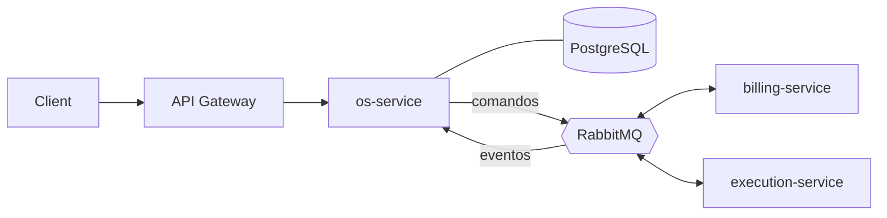

# oficina-os-service

Microsserviço de **Ordem de Serviço** do Sistema Integrado de Atendimento e Execução de Serviços da oficina. É o dono dos cadastros (clientes, veículos, serviços, peças e estoque), da ordem de serviço e do **orquestrador da Saga**.

## Responsabilidades

- CRUD de clientes, veículos, serviços e peças, com controle de estoque.
- Abertura da OS identificando o cliente por CPF/CNPJ, com orçamento calculado a partir dos serviços e peças.
- Status da OS: `RECEIVED` → `IN_DIAGNOSIS` → `AWAITING_APPROVAL` → `IN_EXECUTION` → `FINISHED` → `DELIVERED` (ou `CANCELLED`), alterados automaticamente pelos eventos dos outros serviços.
- Listagem de OS ativas ordenada por status (Em execução > Aguardando aprovação > Diagnóstico > Recebida) e, dentro de cada status, da mais antiga para a mais nova. Finalizadas e entregues não aparecem.
- Tempo médio de execução e tempo médio por status.
- Login administrativo com JWT e notificação do cliente por e-mail a cada mudança de status.

## Tecnologias

NestJS 11, TypeScript, Prisma, PostgreSQL, RabbitMQ, Jest, Cucumber, New Relic, Docker, Kubernetes.

**Por que PostgreSQL:** o domínio é fortemente relacional (cliente → veículos → ordens → itens e histórico) e a reserva de estoque exige atualização atômica e consistência transacional, que um banco relacional entrega nativamente.

## Arquitetura

Clean Architecture, com dependências apontando sempre para dentro:

```
src/
  domain/          entidades, value objects (CPF/CNPJ, placa) e regras de transição de status
  application/     casos de uso, portas (repositórios e gateways) e contratos de mensageria
  infrastructure/  Prisma, RabbitMQ, SMTP, JWT, New Relic
  presentation/    controllers REST, DTOs, guard JWT e filtro de erros
```



## Saga orquestrada

O orquestrador vive neste serviço (`ServiceOrderSaga`). Ele envia **comandos** para `billing` e `execution` e reage aos **eventos** de resposta, guardando o passo atual e o histórico em `service_order_sagas`.

**Por que orquestração:** a OS já é a dona do ciclo de vida e do status exibido ao cliente; concentrar a coordenação nela deixa o fluxo e as compensações em um único lugar, fácil de testar, rastrear e demonstrar. Com coreografia, a regra ficaria espalhada pelos três serviços.

| Passo | Comando enviado | Evento esperado | Efeito na OS |
|---|---|---|---|
| Abertura | `execution.command.open-work-order` | `work-order-opened` | `RECEIVED`, estoque reservado |
| Diagnóstico | — | `diagnosis-started` / `diagnosis-completed` | `IN_DIAGNOSIS` |
| Orçamento | `billing.command.generate-budget` | `budget-generated` | `AWAITING_APPROVAL` |
| Aprovação e pagamento | — | `budget-approved` / `payment-confirmed` | link de pagamento registrado |
| Execução | `execution.command.enqueue-repair` | `repair-queued` / `repair-started` / `repair-completed` | `IN_EXECUTION` → `FINISHED` |

Compensações:

| Falha | Compensação |
|---|---|
| Ordem de trabalho não pôde ser aberta | cancela a OS e devolve o estoque |
| Geração do orçamento falhou, orçamento recusado ou pagamento falhou | cancela a OS, devolve o estoque e cancela a ordem de trabalho |
| Reparo falhou | cancela a OS, devolve o estoque e solicita o estorno do pagamento |
| Cancelamento administrativo | as três acima, conforme o passo em que a saga está |

O estado da saga pode ser consultado em `GET /service-orders/:id/saga`.

## Execução local

```bash
docker compose up --build
```

A API sobe em `http://localhost:3001`, o Swagger em `http://localhost:3001/docs/os`, o RabbitMQ em `http://localhost:15672` e a caixa de e-mails em `http://localhost:8025`. O usuário administrativo padrão é `admin@oficina.com` / `admin123`.

Para o fluxo completo com os três microsserviços, use o `docker-compose.yml` em `oficina-infra-k8s/local`.

Sem Docker para a aplicação:

```bash
cp .env.example .env
npm install
npx prisma migrate deploy
npm run start:dev
```

## Testes

```bash
npm run test:cov
```

```bash
npm run test:bdd
```

Cobertura atual: **99% de linhas** (61 testes unitários e de integração) e 3 cenários BDD cobrindo o fluxo completo, a recusa do orçamento e a falha no reparo. O relatório fica em `coverage/` e é publicado como artefato da pipeline e no SonarCloud.

## Deploy

A pipeline (`.github/workflows/ci-cd.yml`) roda lint, testes, BDD, build e SonarCloud em todo pull request. Em `develop` faz deploy no namespace `oficina-hml` e em `main` no `oficina-prod`.

Configuração no GitHub:

| Tipo | Nome |
|---|---|
| Secrets | `AWS_ACCESS_KEY_ID`, `AWS_SECRET_ACCESS_KEY`, `SONAR_TOKEN`, `DATABASE_URL`, `RABBITMQ_URL`, `JWT_SECRET`, `ADMIN_PASSWORD`, `NEW_RELIC_LICENSE_KEY`, `SMTP_HOST`, `SMTP_PORT`, `SMTP_USER`, `SMTP_PASSWORD` |
| Variables | `AWS_REGION`, `EKS_CLUSTER`, `SONAR_PROJECT_KEY`, `SONAR_ORGANIZATION` |

`DATABASE_URL` deve ser definido por environment (`homologation` e `production`), por exemplo `postgresql://oficina:<senha>@<endpoint-rds>:5432/os_service_prod?sslmode=require`. O `JWT_SECRET` precisa ser o mesmo nos três microsserviços e na Lambda.

Deploy manual:

```bash
for manifest in k8s/*.yaml; do envsubst < "$manifest" | kubectl apply -n oficina-prod -f -; done
```

## Observabilidade

- Logs em JSON com `correlationId`, propagado pelo header `x-correlation-id` e pelas mensagens do RabbitMQ.
- Agente New Relic (APM e distributed tracing) habilitado quando `NEW_RELIC_LICENSE_KEY` está definido.
- Eventos de negócio `ServiceOrderStatusChanged` e `ServiceOrderSagaCompensated`, usados nos dashboards de volume diário, tempo por status e falhas.

## APIs

Swagger em `/docs/os` e collection do Postman em `oficina.postman_collection.json`.
